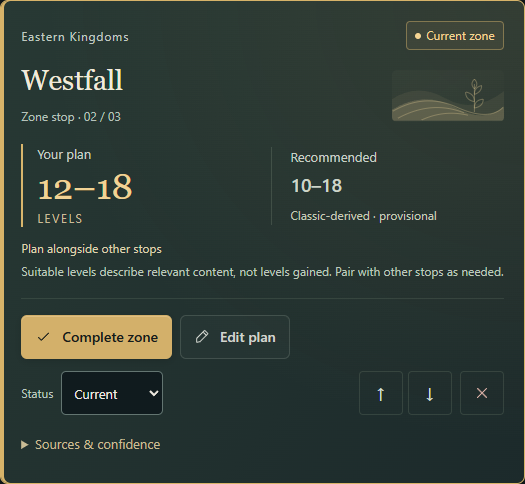
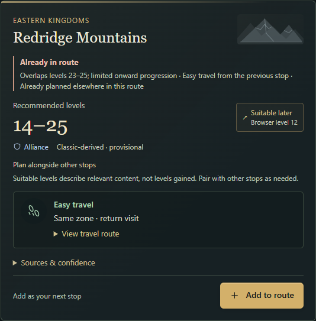
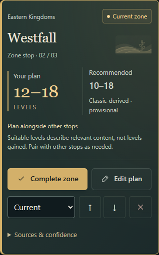
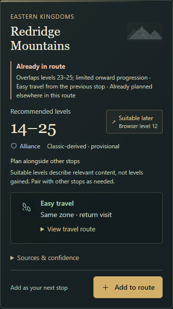

# Pass 4.5: character starts, next destinations and planning clarity

Stacked on PR #5, `codex/leveling-journey-visuals` at `c276b984`. This pass keeps the existing journey layout, profile schema, persistence, route editing and graph. No production hosting changes or merge are included.

## Behaviour

New characters use native race, available-class and class-specific specialisation dropdowns from reviewed official Forever announcements. Faction is derived from the chosen race affiliation. Both Skyborne affiliations are explicit choices; saved canonical fields and profile schema stay compatible. A suitable race starting zone is selected by default, with a freely chosen friend destination or blank route available. Advanced characters do not default to an outgrown starting zone. Existing imported labels and routes survive unrelated edits. See [the character catalogue](character-options.md).

Suggestions now compare the next content bracket first, then travel. A known preceding zone anchors the final three integer levels of its suitable range, rather than allowing an unusually long personal exit to push the browser far ahead. A higher browser/character level overrides an outgrown bracket. Matching fresh destinations must overlap the window and extend its upper range; travel compares both legs for a middle insertion. Explicit categories and ASCII IDs make ordering deterministic. A Troll Shaman with Durotar sees The Barrens first and Silverpine second; Silverpine can also lead on to The Barrens despite their shared lower bound. The complete catalogue remains available, and suitability badges still name their browser level. See [the comparison rules](route-relevance.md).

The full [45-zone range audit](zone-range-review.md) rechecked source values without manufacturing new endpoints. All 38 provisional Classic-derived ranges match their cited sources; the one official numeric range, Riverglades editorial correction, and five unknown ranges remain distinct. The review revision is `forever-zones-2026-10-13.3`.

Suitable content levels, personal planned levels and coverage advice remain separate. Soft notes do not claim a measured XP yield or typical duration. A known zone planned for eight or more level gains gets an editorial review prompt; all valid personal ranges can still be saved. Unknown guidance stays explicit. Riverglades is now 35–45, recorded as a low-confidence owner-requested editorial correction rather than official confirmation. See [guidance and its limits](zone-guidance.md) and [field provenance](zone-provenance.md).

Six original SVG landscape families and a neutral atlas motif occupy reserved header space, with smaller mobile sizing. They never sit behind text. Unmapped/new zones use the neutral ornament rather than inferred geography. These are decorative journal sketches, not maps or game assets; there are no external images, downloads or new dependencies. Travel labels and manual route states retain their text, controls and prominence.

## Executed validation

- `npm test`: **228 passed** (24 class draft + 204 companion).
- `npm run build`: TypeScript and combined static production build passed.
- `npm run test:build`: **9 passed**, including compiled nested assets, redirects, direct links and publishing allowlist.
- Full browser suites: **105 cases passed** (21 class draft + 84 companion). The initial combined entrypoint had one timeout in the unchanged class-draft edit/invalidation case; its entire 21-case suite passed on an isolated rerun, with no class-draft code or assertion changes. The complete 84-case companion source suite passed independently.
- Full companion suite repeated against compiled `/companion/`: **84 passed**. Ignored local configurations used isolated ports 4275, 5273 and 5274; no unrelated process was stopped or reused.
- New character cases cover official combinations, dependent class/spec resets, derived factions, Skyborne affiliations, default Durotar and Barrens/Silverpine ordering, friend and blank starts, advanced levels, saved legacy values, reload, desktop/mobile accessibility and screenshots. Ranking cases cover real source brackets, equal-entry progression, arbitrary personal stays, middle-insertion travel, repeats, unknowns and deterministic ordering.
- Existing suites retain route CRUD/reorder, travel recomputation, Next Up, character/profile isolation, export/import, migration, backups, observed multi-tab conflicts, touch, keyboard, reduced motion and responsive layouts. The prior unknown-range screenshot fixture now uses Moonglade because Riverglades has a range.
- WCAG AA automated checks and overflow checks pass, including desktop/mobile motif checks. Local rendered tests use installed Edge (Chromium). No human screen-reader audit or gameplay verification is claimed.
- Direct in-app-browser inspection exercised the compiled Troll/Shaman/Enhancement creation flow, derived Horde, default Durotar, Barrens/Silverpine ordering, and a personal Durotar 1–60 plan saved and reloaded while suggestions retained the correct 10–12 bracket. No console warnings or errors were observed. Desktop/mobile screenshots were opened and visually inspected.
- `git diff --check`: passed.

## Rendered captures

Desktop viewport 1440 px; mobile 390 px. Crops retain the complete destination cards so names, personal/recommended levels, guidance, travel and actions can be assessed.

| | Character form | New route | Next destinations |
| --- | --- | --- | --- |
| Desktop | [Form](images/character-followup/character-form-desktop.png) | [Route](images/character-followup/character-route-desktop.png) | [Browser](images/character-followup/character-browser-desktop.png) |
| Mobile | [Form](images/character-followup/character-form-mobile.png) | [Route](images/character-followup/character-route-mobile.png) | [Browser](images/character-followup/character-browser-mobile.png) |

| | Route card | Browser card |
| --- | --- | --- |
| Desktop |  |  |
| Mobile |  |  |

Cloudflare preview and exact-head CI outcomes are recorded in the draft PR after publication. Production `main` and its site remain unchanged.
