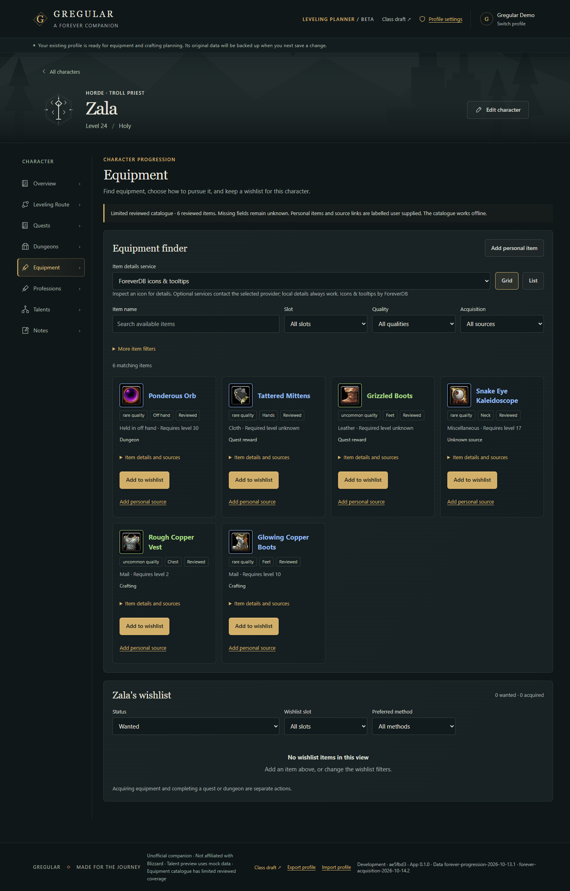
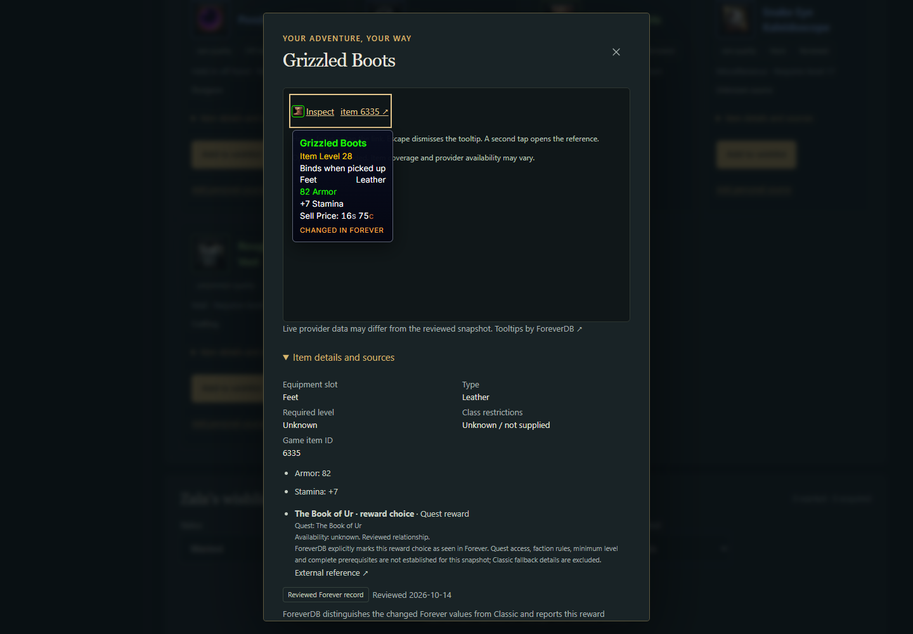
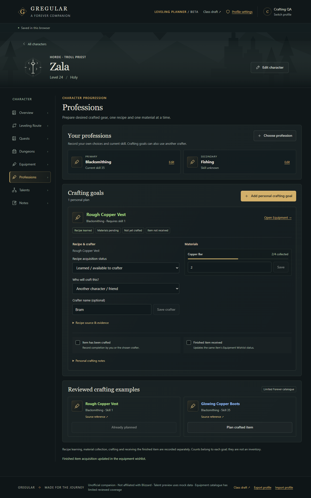

# Pass 6: equipment, provider integration and crafting

Reviewed 14 October 2026, Pacific/Auckland. This is a stacked draft on PR #7,
`codex/connected-progression-planner` at `ae5fbd3`. Earlier drafts remain open.
There is no merge, production deployment, DNS or hosting configuration change.

## Result

Equipment now has compact quality-coloured cards, optional actual ForeverDB
icons, grid/list views, practical search/filter controls and independent wishlist
actions. Hover/focus shows a concise local preview; activating the icon opens
full local details and, when enabled, an isolated genuine provider tooltip.
Inside that panel, hover/focus/tap the provider link to inspect its live tooltip.
This deliberate two-stage interaction keeps third-party overlays away from the
wishlist controls. Mouse, keyboard and touch can always inspect local details.

Choose **ForeverDB icons & tooltips** once in Equipment. This opt-in lasts for
the browser tab; it is a display preference, separate from character exports.
Local details are the initial default. Unsupported or failed icons show an
explicit neutral **No icon** placeholder, never invented item art.

Professions records primary/secondary choices and optional current skills.
Reviewed crafted items and personal recipes use the existing wishlist and typed
acquisition graph. Recipe learning, per-goal materials collected, craft
completion, crafter choice/name and finished-item receipt are independent.
Removing equipment retains saved preparation. Sharing a material reference does
not share collected counts. Self-craft does not require imposing unknown game
profession caps; another crafter remains a personal plan rather than a claim
that a bind-on-pickup item is transferable.

The six-item curated catalogue adds Rough Copper Vest and Glowing Copper Boots:

| Item | Reviewed requirements |
| --- | --- |
| Rough Copper Vest, 10421 | Blacksmithing 1; 4 Copper Bar |
| Glowing Copper Boots, 250482 | Blacksmithing 35; 2 Copper Bar, 4 Lesser Magic Essence, 2 Light Leather |

Recipe-learning source, game recipe/material IDs and special requirements remain
unknown. See [provider research and field sources](item-data-integration.md).

## Architecture decision

Select a **hybrid**: compact local discovery data, a small reviewed relationship
graph, optional documented external details/icons, and permanent manual entry.
No inspected provider established a sufficiently documented and permitted
complete Forever search/acquisition API or reusable bulk discovery dataset.
QuestieDB is a credible acquisition lead with inherited-field and licence gaps;
its inspected item schema also lacks several required discovery fields.

No bulk importer is shipped. The report specifies an edition/build/revision,
hash/licence manifest, deterministic normalization, validation, update diffs,
compression/lazy-loading and removed-record behavior for a future permitted
input. This pass's small reviewed snapshot is reproducible from tracked source.

Provider scripts run only in an opaque sandbox with no parent DOM/storage or
top-navigation access. They own their entire document, never React's children.
The icon bridge observes the documented decoration option and sends only
source-window-validated, ID-bound, allowlisted icon URLs. Gregular never calls
the providers' internal data transports itself or injects their HTML into React.
Strict frame CSP allows only the documented provider hosts and required styles,
fonts/images. Each inspection owns its frame; there is no unbounded provider
observer attached to the planner. Icons are restricted to this curated sample,
not an unreviewed arbitrary remote catalogue.

ForeverDB worked across origin `null`; actual icons and new/changed Forever
tooltips rendered. Its provider tooltip has a role but no observed
`aria-describedby` association, so Gregular's local associated preview and full
details remain the accessible fallback. wow-forever.gg's documented script
loaded, but its item transport lacked the CORS response needed by the opaque
sandbox. It is excluded from the service menu. Its separate live comparison
checks the failure without proxying or weakening provider restrictions.

## Persistence

Schema **4** adds independent `character.crafting`. Imports accept v1–v4.
Loading v1–v3 is read-only; first save retains the exact old raw JSON once under
the appropriate migration backup key, including `:backup:v3`. Backup failure
protects the old save. Replacement recovery, retained unknown references,
profile/character isolation and observed stale-tab protection remain active.
New exports round-trip professions, personal recipes/material references,
per-goal counts, crafter and independent acquisition states. Older builds cannot
read v4 exports; keep original exports and migration backups when reviewing the
stack. Storage remains browser/origin-local and best-effort across tabs.

## Demonstration

1. Open a preview, import the optional demonstration profile or select/create a
   character, then open Equipment.
2. Select ForeverDB icons & tooltips. Search **Ponderous Orb**, focus/hover its
   icon, activate it and focus/hover/tap the provider link. Dismiss with Escape
   or the dialog Close control. Local level/stats/source details remain below.
3. Add to wishlist. Its selected source is Shade of the Archmage, City of
   Dalaran. Open the dungeon goal; recording a run does not acquire the item.
4. Search **Tattered Mittens** and wishlist it to inspect the shared Book of Ur
   quest reward relationship. Open the quest goal; prerequisites remain unknown.
5. Open Professions, choose **Blacksmithing** and record skill **35**. Add a
   secondary profession if desired; no unverified game limit is enforced.
6. Plan Rough Copper Vest from the reviewed examples (or wishlist it from
   Equipment). Inspect its recipe evidence and **4 Copper Bar** requirement.
7. Record **2 collected**, choose **Another character / friend**, enter a name
   and save it. Recipe learned, item crafted and finished item received can each
   be changed without completing the others. Try self-craft or undecided too.
8. Add a personal crafting goal with user-authored material quantities. Separate
   goals may reuse a material name/reference while retaining separate counts.
9. Return to Overview for outstanding equipment and crafting summaries. Routes
   keep their previous order and completion; no source automatically inserts work.
10. Export via Profile settings. Import into another browser context, open the
    character and reload. The automated scenario compares all character data,
    including the 2/4 count and crafter name, after import.
11. Block `foreverdb.net` (or select Local details only), reload/open Equipment
    and repeat inspection/wishlisting. Local details, neutral placeholders and
    controls still work. A deterministic browser case blocks the provider.

The downloadable `crafting-demo-profile.json` is synthetic user planning data,
not an actual player save or a claim that a recipe has been learned in game.

## Validation

Final local suite and remote preview results are recorded in the draft PR.
The deterministic suite has no external service dependency; live provider checks
use `playwright.providers.config.mjs` with separate output and are run explicitly.

- **312 unit tests passed** (24 original draft + 288 companion). Typecheck and combined production build passed; **10 compiled static/HTTP checks passed**.
- **125 source browser cases passed across runs** (21 original + 104 companion): full companion run passed 103/104; its remaining schema-upgrade copy expectation was updated from version 3 to 4, then all 13 profile-import cases passed. **All 104 companion cases passed in one complete compiled `/companion/` run**. Final Linux CI is reported separately in the PR.
- Live comparison: ForeverDB success; wow-forever.gg CORS fallback observed.
- Live ForeverDB mouse hover, focus/Escape, touch and missing-record plain-link
  fallback passed. Blocked script and failed icon fallbacks use deterministic mocks.
- Desktop 1440, tablet 820 and mobile 390 accessibility/overflow checks; retained
  responsive cases also cover 320px. Screenshots were opened and inspected.
- No physical-device, game-client or human screen-reader audit is claimed.

Earlier local browser iterations exposed exact-label selection issues, a shared
icon deduplication error, long source-label bounds and unrelated preferred-source
derivation. These were corrected with focused checks before the full runs.
Windows sandbox network restrictions required permitted local HTTP/browser
execution; failures from denied local HTTP are not application test failures.

[Equipment mobile](images/pass-6/equipment-mobile.png) ·
[Professions mobile](images/pass-6/professions-mobile.png)
