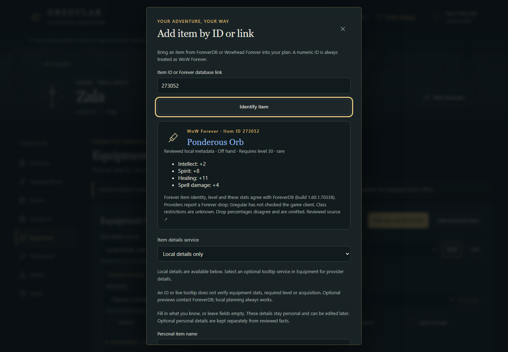
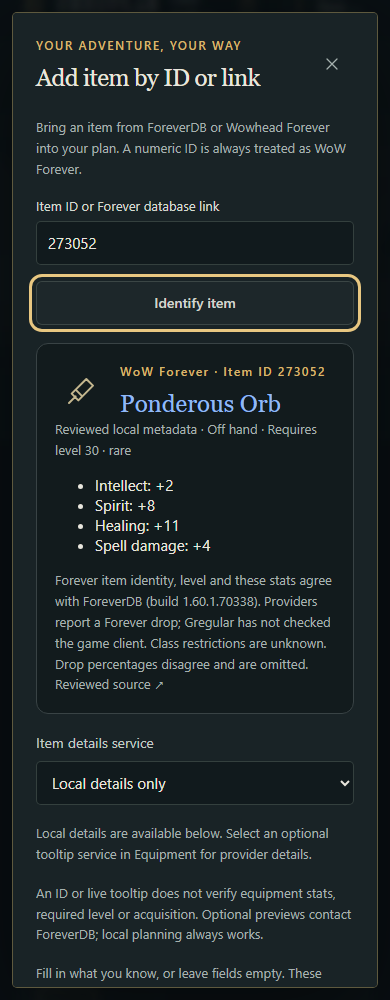
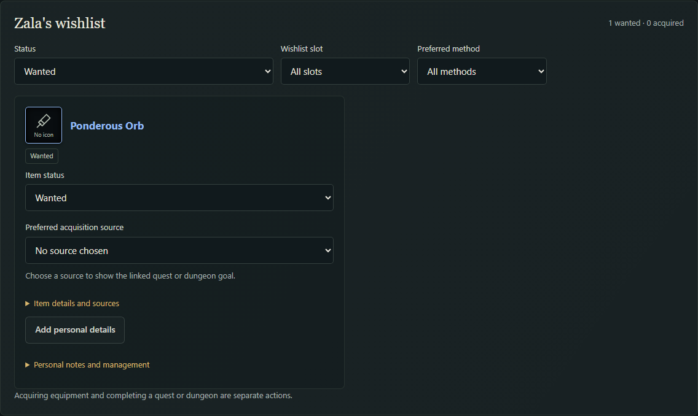
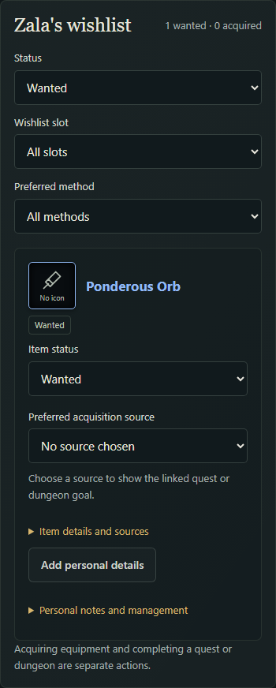

# Pass 8: Forever item identity and personal catalogue entry

Reviewed **14 October 2026, Pacific/Auckland**. Based on PR #9's
`codex/gear-discovery` at `b60c53e7230bda48a947fc51fbe7ed71396198cd`.
The new `codex/forever-item-entry` branch targets that branch as a stacked draft
PR. Production hosting, DNS and the existing PR stack are preserved.

## Decision and counts

**Path B** is the selected result. The focused [source assessment](forever-item-data-decision.md)
did not establish a structured Forever equipment source with both supported
access and adequate redistribution permission. It records the strongest
candidates, field gaps, build identity, rights boundaries and specific questions
the owner can take to providers. No provider was contacted or access restriction
bypassed. Do not repeat the broad investigation without a concrete permitted input.

**Zero new reviewed/imported item records were added. The six existing reviewed
equipment records remain intact.** QA-only unknown IDs are isolated tests, not
claims that those items exist or additions to the shipped catalogue. Players
can now wishlist any valid Forever ID independently of local catalogue coverage.
ID validation identifies a chosen identity; it cannot prove that the item exists,
is equippable, is obtainable, or is available in the current build.

## Delivered experience

1. Open a character's Equipment page and choose **Add item by ID or link**.
2. Paste a decimal ID, a ForeverDB item link, a Wowhead `/forever/item=...` link,
   or the documented wow-forever.gg item-link format. Choose **Identify item**.
3. See the explicit Forever identity and any reviewed local metadata. Unsupported
   hosts, other game variants, ambiguous tracking links and malformed IDs are rejected.
4. Optionally select ForeverDB for its existing sandboxed icon/tooltip preview.
   Local details and ordinary provider links remain usable without that service.
5. Supply a personal name, quality, equipment slot/type, required level, numeric
   bonuses or descriptive effects, or leave them unknown. Add the item to the wishlist.
6. Use **Edit personal details**, **Add personal details**, wishlist notes and
   **Add source link** later. Personal quest/dungeon/vendor/crafting/world
   associations reuse the existing acquisition graph and preserve unknown access.

Reviewed and personal facts stay separate, including when a reviewed item has
missing fields. Reviewed items remain one search result; their optional personal
details have a separate disclosure and editor. Personal values are never silently
merged into the reviewed search index. For an unknown personal item, explicitly
entered numeric fields participate in the existing name/stat/level/quality/slot
search with user-supplied provenance. Descriptive effects do not become numeric
bonuses. Blank values are unknown; an explicitly entered zero remains zero.

No tooltip text is parsed into authoritative metadata. No required level, source,
drop location, quest reward location, class restriction or build is inferred
from an ID or a successful tooltip. No automatic best-in-slot or upgrade score
is introduced.

## Storage, updates and addon boundary

The [reusable contract](item-data-contract.md) specifies identity v1
`{ gameVariant: "wow-forever", gameId }`, permitted URL forms, saved references,
personal overlays, missing snapshots and independent acquisition relationships.
Existing profile schema 4 gains optional identity fields, with existing profile
validation, import/export, backups and conflict protection unchanged in purpose.
The shared catalogue is not copied into every character.

A future reviewed snapshot coalesces the same identity into one result while
retaining the original personal details and wishlist reference. Source item
edges, quest rewards and shared/personal crafting outputs resolve through that
identity without rewriting saved records. A removed reference can display an
identity-only placeholder with unknown details rather than losing the plan.

For future growth, keep the reviewed core, permitted versioned import snapshots
and user-authored facts separate. Require a source/build/rights manifest and
deterministic field/relationship diffs before accepting an import. See
[source licences](source-licenses.md). The next functional project can proceed
to the character addon: equipped game IDs need not exist in this catalogue.
No addon was built in this pass.

## Static-site performance

The new item editor loads as a separate chunk only when opened. Measured local
compiled sizes: editor **8.44 kB / 3.05 kB gzip**, its CSS **0.70 kB / 0.36 kB
gzip**; main app **526.78 kB / 151.51 kB gzip**, main CSS **94.57 kB / 20.00 kB
gzip**. These are build output sizes, not browser transfer timings. The main
chunk still emits Vite's size warning; this pass does not claim it solved general
bundle size. No actual imported dataset exists to benchmark, and no synthetic
count is presented as real coverage.

The existing 36-result pagination and 12-ID documented provider batches remain.
Search is provider-independent; tooltips are requested for inspection and icons
only after opt-in. Six shared records do not justify a new catalogue service.
When a permitted larger snapshot arrives, use separate immutable searchable JSON
and acquisition payloads, load on Equipment entry, and measure actual browser
cost before category/unknown-level shards or virtualization. Do not include full
tooltip markup in the search payload.

## Validation

Local deterministic checks completed before PR publication:

- Typecheck and production build.
- **397 companion unit tests and 24 class-draft tests**. New coverage includes
  variants, supported/hostile links, duplicates and imported aliases, immutable
  identities, numeric zero/unknown, descriptive effects, snapshot collisions,
  missing snapshots, personal overlays and quest/dungeon/crafting continuity.
- Existing **111 companion browser regressions and 21 class-draft browser tests**
  passed. This includes route-aware discovery, ANY/ALL stats, crafting,
  migrations, backup recovery, profile transfers and multi-tab conflict protection.
- **17 item-entry browser tests**, including JSON round-trips, independent
  characters, provider failures and mocked icon fallback, passed after correcting
  two test selectors that included label help text in their accessible names.
- The same **17 feature tests pass against compiled `/companion/` output**.
- **10 static-output checks** verify nested assets, provider sandbox files,
  redirects, missing paths, demo JSON, and preserved class-draft/domain files.
- Desktop 1440 px, tablet 820 px and mobile 390 px checks passed, with visible
  keyboard focus, Escape/focus return, touch entry/editing, no horizontal overflow
  and zero violations in the exercised axe WCAG 2 A/AA and 2.1 AA checks.

The first overlapping local browser runs shared a test-server lifetime and were
discarded; final runs were sequenced. Live-provider availability never gates the
deterministic suite. Separate optional live ForeverDB checks passed for reviewed
stat results with icons, keyboard/touch tooltip display, and missing-record
plain-link fallback. This verifies current presentation, not dataset completeness
or in-game item values. No human in-game validation was performed.

GitHub CI, the immutable Cloudflare Pages preview URL and its commit verification
are reported in the PR description and delivered validation report after the
remote services complete. The pre-existing `Workers Builds: gregular-preview`
failure is independent of Cloudflare Pages and must be reported separately.

## Screenshots

All captures show local test profiles, not personal user data. Providers are
blocked for deterministic screenshots; neutral icons are intentional. No mocked
art is presented as a real provider asset.

