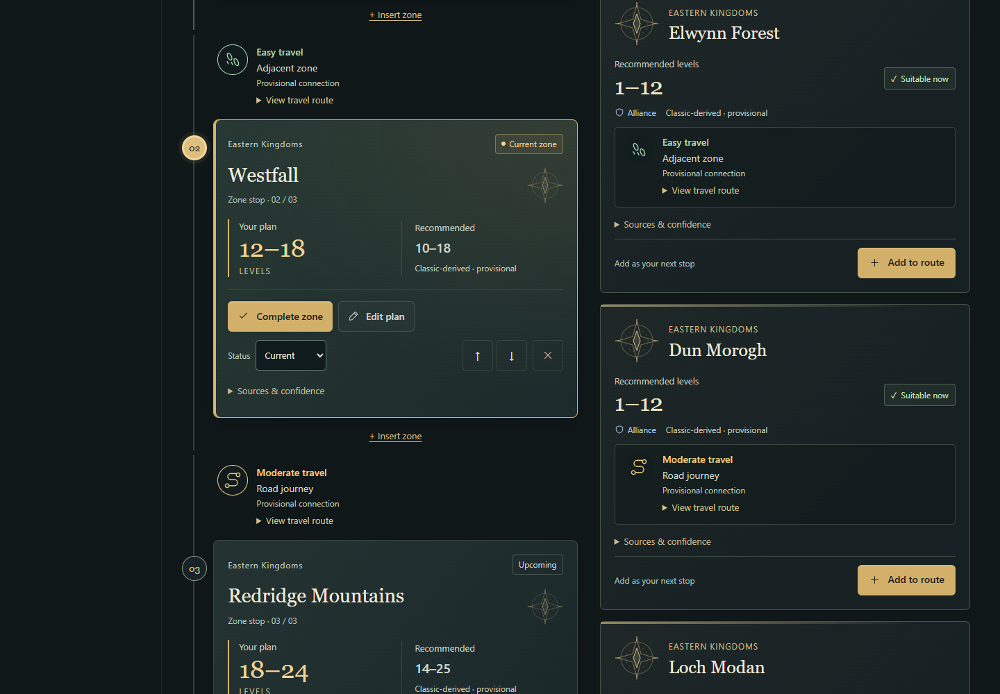
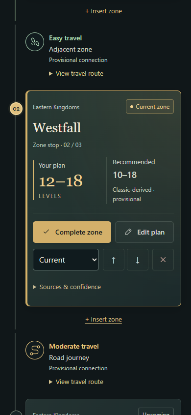

# Pass 4 — a readable leveling journey

This visual pass is stacked on PR #4, `codex/zone-first-route-builder` at `7bac024`. It changes presentation and direct access to existing actions. The zone catalogue, recommendations, travel graph and weights, faction rules, route progression, profile schema and persistence code are unchanged.

## Design

- **Know where you are:** the overview shows character level, the current or suggested zone, its personal range, the following destination and relative travel overhead. Segmented marks count saved stops; their accessible label explicitly says this is not XP progress. Empty and resolved routes retain an Add zone action.
- **Read the journey:** numbered waypoints and a connected path give stops an order. Completed stops have checks and a quiet green surface; the current focus has a gold border, marker and prominent personal levels. Upcoming, skipped and earlier unfinished visits have explicit labels. A level change never completes a visit.
- **Separate your plan from guidance:** personal ranges use large gold numbers. Smaller recommended ranges retain visible provisional or unresolved labels. The level editor keeps both the recommendation and confidence visible above independent entry/exit fields.
- **See the transition:** travel sits between destination shells, within each stop's accessible article. Footsteps, winding roads, boats, zeppelins and other supported transport icons are derived from selected graph edges. Grey uncertainty is explicit. Path explanations, individual edges and source links are expandable. Difficulty describes that transition, not the destination.
- **Browse an atlas:** original compass graphics, continent accents, large names and recommended levels, faction and suitability labels replace the database-style cards. Search, level, faction, continent, travel and insertion controls remain visible. Filters and insertion keep their existing rules. No game map or third-party artwork is introduced.
- **Act without hunting:** Complete, Reactivate and Edit are direct actions; status, keyboard reorder and removal stay in a compact secondary row. Removal and clearing retain their confirmation dialogs. Add zone focuses search and respects reduced motion.
- **Read comfortably:** shared typography tokens establish 15px body, 14px controls and 12–13px metadata. Fantasy serif headings pair with familiar sans serif controls. The wider desktop workspace gives both columns room; laptop/tablet layouts stack the route before two-column discovery; phones use a single page scroll with 44px controls and no hover dependencies.

`routePresentation.tsx` contains reusable range badges, confidence disclosure, cartographic marks and travel presentation. `ZoneBrowser.tsx` separates discovery presentation from route editing. Shared styles load before component styles so their cascade remains predictable.

## Validation

Reviewed on 13 October 2026. Local rendered checks use installed Microsoft Edge (Chromium), including the compiled application served at `/companion/`. The existing class draft is checked independently.

| Check | Result |
| --- | --- |
| TypeScript and combined production build | Pass |
| Class-draft unit tests | 24 pass |
| Companion unit tests | 154 pass, including 3 new transport-presentation cases |
| Existing class-draft browser tests | 21 pass |
| Compiled companion browser tests | 69 pass: 58 existing + 11 new |
| Compiled static/HTTP compatibility checks | 9 pass |

The original 58 companion browser cases and their assertions are retained. New coverage exercises direct complete/reactivate actions; suggested versus earlier unfinished states; selected transport icons; connector placement; keyboard reorder and modal focus restoration; manual-state persistence; overview empty/resolved states; desktop/laptop/tablet/mobile rendered layouts; actual computed text sizes, including large editor fields; reduced motion; touch targets and taps; overflow and axe WCAG AA checks. Existing suites continue to exercise reload, JSON export/import, backup recovery, character isolation, multi-tab conflicts, faction filtering, insertion, skipped visits and the other dashboard sections.

Screenshots are opened and visually inspected, rather than only generated. The review found and corrected inherited small filter fonts, a search-icon overlap, a base/component stylesheet cascade problem affecting large numeric fields and panel treatments, and excess destination-card spacing. Live in-app browser review also exercised character creation, dashboard navigation, planning and the level editor. Automated axe checks include colour contrast; no human assistive-technology audit or in-game route verification is claimed.

## Before and after

The paired captures use the same three-stop profile, level and suitability filter. The earlier screenshots are rendered from the unmodified PR #4 source; the new screenshots show this pass. The focus views scroll to the current stop so names, planned/recommended ranges, travel and actions can be compared at original viewport size.

| Viewport | Before | After |
| --- | --- | --- |
| Desktop 1440px | [Before](images/visual-pass/before-desktop.png) | [After](images/visual-pass/after-desktop.png) |
| Laptop 1024px | [Before](images/visual-pass/before-laptop.png) | [After](images/visual-pass/after-laptop.png) |
| Tablet 820px | [Before](images/visual-pass/before-tablet.png) | [After](images/visual-pass/after-tablet.png) |
| Mobile 390px | [Before](images/visual-pass/before-mobile.png) | [After](images/visual-pass/after-mobile.png) |

[Mobile editor](images/visual-pass/editor-mobile.png) · [Desktop overview](images/visual-pass/overview-desktop.png)

| Additional scenario | Captured layout |
| --- | --- |
| Empty route, desktop | [Before](images/visual-pass/before-empty-desktop.png) · [After](images/visual-pass/after-empty-desktop.png) |
| Empty route, mobile | [Before](images/visual-pass/before-empty-mobile.png) · [After](images/visual-pass/after-empty-mobile.png) |
| Easy, moderate, long and unknown transitions; all saved states; long personal title | [Desktop](images/visual-pass/travel-states-desktop.png) |
| Browser search results | [Desktop](images/visual-pass/search-desktop.png) |
| Insertion with both affected transitions | [Tablet](images/visual-pass/insertion-tablet.png) |
| Unknown recommended range | [Mobile](images/visual-pass/unknown-mobile.png) |

The full ignored `artifacts/` matrix includes empty and populated routes, all four travel difficulties, search results, unknown recommended ranges, a long personal location name, insertion and editing at all four widths. Run `COMPANION_BUILT=1 npm run test:companion` with the installed-browser path where required to regenerate the after matrix. Baseline captures are retained locally; they are not regenerated from redesigned source.

## Delivery boundary

The draft PR targets `codex/zone-first-route-builder`, retaining the existing stack. The existing Cloudflare Pages Git integration supplies a branch preview; its URL, commit verification and remote check results are recorded in the PR. Production configuration, DNS and the live domain are untouched. No merge is performed. The separately configured Workers Builds integration is reported independently from Pages and repository verification.
